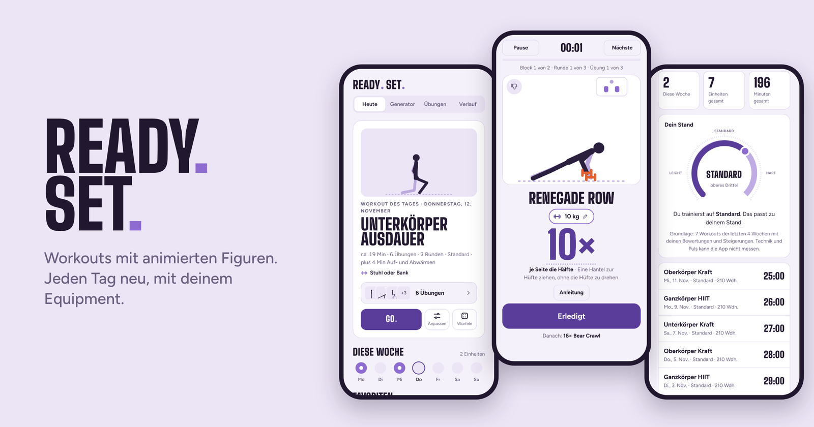
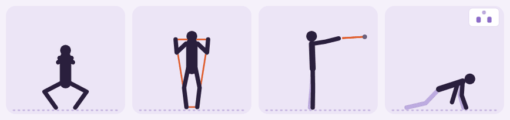
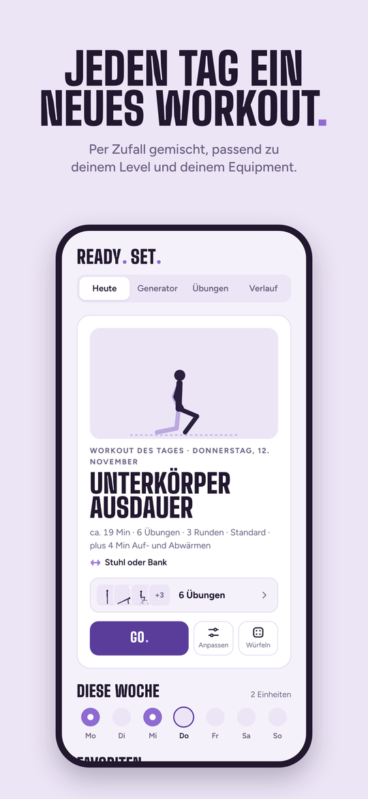
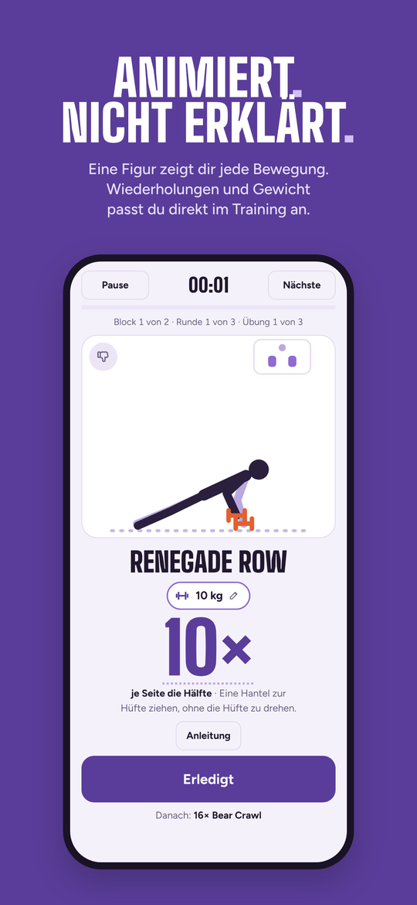
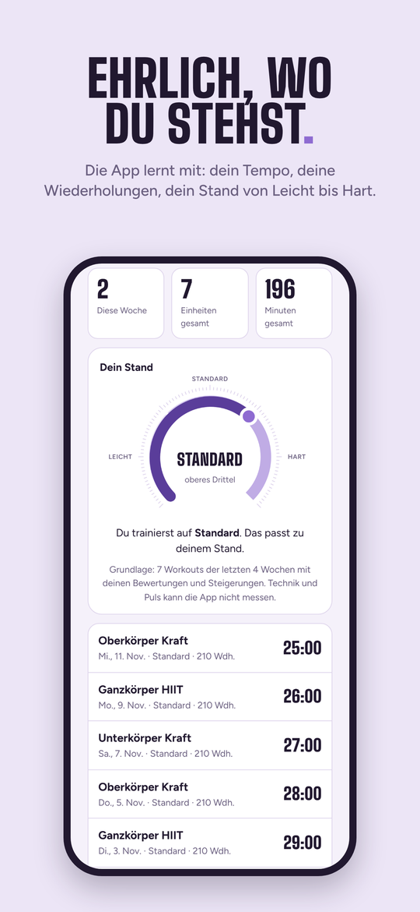
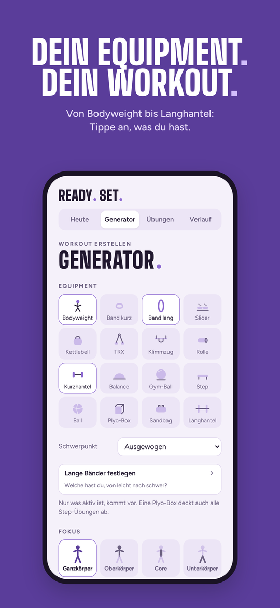

<p align="center">
  
</p>

<h1 align="center">Ready. Set.</h1>

<p align="center">
  <b>Workouts mit animierten Figuren. Jeden Tag neu, mit deinem Equipment.</b><br>
  Kostenlos, ohne Anmeldung, direkt im Browser – und auf dem Handy wie eine App.
</p>

<p align="center">
  <a href="https://alxwll.github.io/readyset/"><b>▶&nbsp; App öffnen</b></a>
</p>

<p align="center">
  
</p>

---

## Was die App kann

🗓️ **Workout des Tages** – Jeden Tag ein neues Workout, passend zu deinem Level und deinen Geräten. Ein Tipp auf „Go.“ und es geht los.

🎛️ **Bau dir dein Workout** – Equipment, Fokus, Trainingsart, Dauer und Abwechslung wählen, fertig ist dein eigenes Workout. Kraft, HIIT, Ausdauer oder Stretching.

🏃 **Animiert statt erklärt** – Über 250 Übungen mit animierten Figuren, Technik-Tipps und leichteren Varianten.

⏱️ **Der Timer zählt mit** – Ansagen, Pausen mit Vorschau auf die nächste Übung, Seitenwechsel bei einseitigen Übungen. Wiederholungen, Gewicht und Bandfarbe passt du direkt im Training an.

📈 **Wird mit dir stärker** – Die App merkt sich dein Tempo, deine Wiederholungen und deine Gewichte. Wird es zu leicht, kommt die schwerere Variante.

🎯 **Weiß, wo du stehst** – Eine ehrliche Einordnung von Leicht bis Hart. Bist du bereit für die nächste Stufe, sagt dir die App Bescheid.

🎨 **Meine Bänder** – Deine eigenen Widerstandsbänder, von leicht nach schwer sortiert. Inklusive Vorschlag, wann das nächste Band dran ist.

🔁 **Tausch, was nervt** – Jede Übung lässt sich gegen eine passende Alternative tauschen. Übungen, die du nicht magst, blendest du mit einem Daumen aus.

---

## So sieht's aus

<p align="center">
  
  
  
  
</p>

---

## Aufs Handy holen

1. **[alxwll.github.io/readyset](https://alxwll.github.io/readyset/)** im Browser öffnen.
2. **Android (Chrome):** Menü ⋮ → **„App installieren“** bzw. „Zum Startbildschirm hinzufügen“.<br>
   **iPhone (Safari):** Teilen-Symbol → **„Zum Home-Bildschirm“**.
3. Fertig. Die App startet im Vollbild, funktioniert auch offline und holt sich Updates automatisch.

🔒 **Deine Daten bleiben bei dir.** Verlauf, Gewichte und Einstellungen liegen auf deinem Gerät, ohne Konto und ohne Anmeldung.

🔗 **Geräte koppeln** – Unter „Verlauf“ bekommst du einen Code mit QR-Code. Auf dem zweiten Gerät eingeben oder scannen, und Handy, Tablet und Laptop bleiben auf demselben Stand. Alles wird auf dem Gerät verschlüsselt, der Server sieht nur unlesbare Daten.

✍️ **Workout per Text** – Im Generator unter „Text“ beschreibst du, was du willst, oder fügst ein fertiges Workout ein. Eine KI stellt es aus den animierten Übungen zusammen.

---

<details>
<summary><b>Technik und Einrichtung</b></summary>

**Aufbau**

```
index.html             die App (wird aus einer einzigen Quelldatei gebaut)
sw.js                  Offline-Speicher
worker/src/index.js    Cloudflare Worker: Text-Workouts per KI, Geräte koppeln
```

**Server einrichten** (einmalig, im Cloudflare-Dashboard)

1. Workers & Pages → Create → „Start with Hello World“, Name `readyset`, Deploy.
2. Edit code → Inhalt von `worker/src/index.js` einfügen → Deploy.
3. Storage & Databases → Workers KV → Create namespace `readyset`.
4. Im Worker: Settings → Bindings → Add → KV namespace, Variable name `RS`, Namespace `readyset`.
5. Settings → Variables and Secrets → Add, Typ *Secret*: `GEMINI_API_KEY` (Pflicht), `GROQ_API_KEY` (optional, Rückfall).
6. Die Worker-Adresse aufrufen. Sie sollte `"ok":true,"ai":true,"kv":true` zeigen.

**Grenzen** (optional als Variablen, Typ *Text*): `PER_DEVICE_DAY` (10), `PER_IP_DAY` (20), `TOTAL_DAY` (100). Dazu die monatliche Ausgabenobergrenze im Google-AI-Studio-Projekt.

</details>

